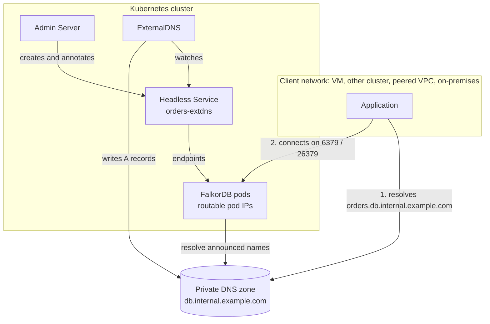

Your applications do not always run in the same Kubernetes cluster as FalkorDB.
They may run on VMs, in another cluster, in a peered VPC, or on premises. To
reach a database from there, clients need two things: a DNS name that resolves
in their network, and a network path to the FalkorDB pods behind that name.

FalkorDB Enterprise handles the database side through the
[external domain](/enterprise/deployment/external-dns) setting. This page covers the
infrastructure you prepare before you turn that setting on: routable pod IPs,
firewall rules, a private DNS zone, and a controller that keeps the zone's
records in step with the pod IPs.

## How the pieces fit together



For a database named `orders` with the external domain
`db.internal.example.com`:

1. The Admin Server creates a headless Service for each database component. It
   annotates each Service with the hostname to publish.
2. A DNS controller, normally ExternalDNS, writes one A record per pod into your
   private zone. Each record points at the pod IP.
3. Each FalkorDB pod announces its own external name. Replicas, Sentinels, and
   cluster redirects therefore hand clients names that resolve outside the
   cluster.
4. The client resolves the name and connects straight to the pod IP. No load
   balancer or kube-proxy hop sits in between.

## Requirements checklist

Everything in this table must hold before you set an external domain. The rest
of this page walks through each item per platform.

| # | Requirement | Why |
| --- | --- | --- |
| 1 | Pod IPs come from an address range that your network routes. | DNS records point at pod IPs. An overlay pod IP is unreachable from outside the cluster. |
| 2 | Routes and firewall rules let clients reach pod IPs on TCP `6379`, plus `26379` for Sentinel. | Without them, names resolve but connections time out. |
| 3 | A private DNS zone exists for the domain. Client networks can resolve it. | Clients must resolve the published names. |
| 4 | The Kubernetes cluster can also resolve the zone. | Pods dial each other's announced names. For example, Sentinel registration connects to the primary's external name. |
| 5 | A controller in the cluster writes records for the annotated Services. | The Admin Server only annotates Services. It never writes DNS records itself. |

<Warning>
  Requirement 4 is easy to miss. If the cluster cannot resolve the external
  names, a replicated deployment with Sentinel stays in `Creating`. Its pods are
  healthy, but KubeBlocks cannot register the primary with Sentinel. To recover,
  fix the DNS setup, or clear the external domain in the **Networking** step of
  the edit wizard.
</Warning>

## Choose a domain

Pick a subdomain dedicated to FalkorDB, for example `db.internal.example.com`.
Do not reuse a zone that holds other records.

- Each database gets names directly under the domain:
  `orders.db.internal.example.com` for data pods, and
  `orders-sent.db.internal.example.com` for Sentinel pods.
- Per-pod names add one more label, for example
  `orders-falkordb-0.orders.db.internal.example.com`.
- ExternalDNS with `policy: sync` deletes records it owns that no longer match a
  Service. A dedicated zone, plus a `domainFilters` entry scoped to it, keeps
  the controller away from unrelated records.

Use a private zone. Pod IPs are private addresses, and publishing them in a
public zone leaks your internal topology.

## Step 1: Make pod IPs routable

Pod IPs are routable only when the CNI assigns them from your VPC or VNet
address space. Check this first, because changing the CNI usually means creating
a new cluster or node pool.

<Tabs>
  <Tab title="EKS">
    The default Amazon VPC CNI (`aws-node`) assigns pod IPs from your VPC
    subnets, so pods are routable by default.

    ```bash
    kubectl get daemonset aws-node -n kube-system
    kubectl get pods -n falkordb -o wide   # pod IPs should be inside your VPC CIDR
    ```

    - **Custom networking** (`ENIConfig`) places pods in separate subnets,
      often from a secondary CIDR such as `100.64.0.0/16`. Add that CIDR to the
      route tables and peering or Transit Gateway attachments that clients use.
    - **Calico, Cilium, or another CNI in overlay mode** replaces the VPC CNI.
      Pod IPs are then not routable. See
      [If pod IPs are not routable](#if-pod-ips-are-not-routable).
  </Tab>
  <Tab title="AKS">
    Pod IPs are routable with Azure CNI in node-subnet mode or with a dedicated
    pod subnet. They are **not** routable with Azure CNI Overlay or kubenet.

    ```bash
    az aks show -g "$RESOURCE_GROUP" -n "$CLUSTER_NAME" --query "{
      plugin: networkProfile.networkPlugin,
      mode: networkProfile.networkPluginMode,
      podSubnet: agentPoolProfiles[0].podSubnetId
    }"
    ```

    | `plugin` | `mode` | Routable? |
    | --- | --- | --- |
    | `azure` | empty | Yes. Pods use the node subnet. |
    | `azure` | empty, with `podSubnet` set | Yes. Pods use the pod subnet. |
    | `azure` | `overlay` | No |
    | `kubenet` | empty | No |

    With a pod subnet, the pod subnet is the CIDR that clients must route to
    and that your network security groups (NSGs) must allow.
  </Tab>
  <Tab title="GKE">
    VPC-native clusters assign pod IPs from a secondary range of the node
    subnet (alias IPs). These pod IPs are routable within the VPC.

    ```bash
    gcloud container clusters describe "$CLUSTER_NAME" --location "$LOCATION" \
      --format="value(ipAllocationPolicy.useIpAliases, clusterIpv4Cidr)"
    ```

    The first value must be `True`. The second value is the pod range that
    clients must reach. Routes-based (non-VPC-native) clusters are not supported
    for direct pod access.

    - **VPC Network Peering** exchanges subnet routes, including secondary
      ranges, by default. Peered VPCs can reach pods without extra routes.
    - **Cloud VPN and Cloud Interconnect**: in its default advertisement mode,
      Cloud Router advertises primary and secondary subnet ranges, including the
      pod range, within its dynamic routing scope. If you use custom
      advertisements, or the cluster is in a region outside that scope, confirm
      the pod range is advertised and add it if it is missing.
  </Tab>
  <Tab title="On-premises and other">
    Pod IPs are routable when the CNI advertises the pod CIDR to your network
    without encapsulation, for example:

    - Calico or Cilium in BGP mode, peered with your top-of-rack routers.
    - Cilium native routing, with static routes for each node's pod CIDR on
      your routers.

    VXLAN, IPIP, Geneve, and Flannel overlays are not routable. On k3s, the
    default Flannel VXLAN backend is an overlay.
  </Tab>
</Tabs>

### If pod IPs are not routable

A `LoadBalancer` Service (see [Networking](/enterprise/databases/networking)) is a
working alternative only for **standalone** deployments, and only without an
external domain. Clients then connect to the load balancer address.

It does not work for replication with Sentinel or for sharded deployments.
Sentinel returns the primary's pod address, and sharded deployments answer
`CLUSTER SLOTS` and `MOVED` redirects with each node's pod address. A single
load balancer only gives clients a first address to connect to; the addresses
they are then sent to are still unreachable. These topologies need routable
pod IPs.

## Step 2: Open the network path

Clients connect directly to pod IPs, so firewall rules must target the pod
address range, not a load balancer.

| Topology | Client must reach | Ports |
| --- | --- | --- |
| Standalone or replication | Every FalkorDB pod | TCP `6379` |
| Replication with Sentinel | Every FalkorDB pod and every Sentinel pod | TCP `6379` and `26379` |
| Sharded | Every shard pod. Clients follow `MOVED` redirects to any of them. | TCP `6379` |

Clients never need the cluster bus port `16379`. Only pods inside the cluster use
it.

<Tabs>
  <Tab title="EKS">
    With the VPC CNI, pods use the security groups of the node's network
    interface. In most clusters this is the EKS cluster security group. Allow the
    client CIDR on that group:

    ```bash
    NODE_SG=$(aws eks describe-cluster --name "$CLUSTER_NAME" \
      --query 'cluster.resourcesVpcConfig.clusterSecurityGroupId' --output text)

    aws ec2 authorize-security-group-ingress --group-id "$NODE_SG" \
      --ip-permissions \
        'IpProtocol=tcp,FromPort=6379,ToPort=6379,IpRanges=[{CidrIp=10.20.0.0/16,Description=falkordb-clients}]' \
        'IpProtocol=tcp,FromPort=26379,ToPort=26379,IpRanges=[{CidrIp=10.20.0.0/16,Description=falkordb-sentinel-clients}]'
    ```

    Replace `10.20.0.0/16` with your client CIDR. If you use security groups
    for pods (`SecurityGroupPolicy`), add the rule to the group attached to the
    FalkorDB pods instead. With custom networking, add it to the security group
    in the `ENIConfig`. Also check the network ACLs on the pod subnets.
  </Tab>
  <Tab title="AKS">
    Add an inbound rule to the NSG on the node subnet, or on the pod subnet if
    you use one:

    ```bash
    az network nsg rule create -g "$NSG_RESOURCE_GROUP" --nsg-name "$NSG_NAME" \
      -n allow-falkordb-clients --priority 300 --direction Inbound --access Allow \
      --protocol Tcp --source-address-prefixes 10.20.0.0/16 \
      --destination-address-prefixes "$POD_CIDR" \
      --destination-port-ranges 6379 26379
    ```

    For peered VNets, enable **Allow forwarded traffic** on both sides of the
    peering if traffic passes through a hub or a network virtual appliance
    (NVA). If an Azure Firewall or NVA filters east-west traffic, allow the same
    ports there.
  </Tab>
  <Tab title="GKE">
    VPC firewall rules apply to pod IPs through the node they run on. Target
    the node network tag or the node service account:

    ```bash
    gcloud compute firewall-rules create allow-falkordb-clients \
      --network "$NETWORK" --direction INGRESS --action ALLOW \
      --rules tcp:6379,tcp:26379 \
      --source-ranges 10.20.0.0/16 \
      --target-tags "$NODE_TAG"
    ```

    Find the node tag with:

    ```bash
    gcloud compute instances describe "$NODE_NAME" --zone "$ZONE" --format="value(tags.items)"
    ```
  </Tab>
</Tabs>

### Kubernetes NetworkPolicy

The chart's [network policies](/enterprise/reference/network-policy) cover only the
Admin Server and Admin UI. They do not restrict database pods. If you apply your
own default-deny policy to a database namespace, allow the client CIDR
explicitly:

```yaml
apiVersion: networking.k8s.io/v1
kind: NetworkPolicy
metadata:
  name: allow-falkordb-clients
  namespace: falkordb
spec:
  podSelector:
    matchLabels:
      app.kubernetes.io/instance: orders
  policyTypes: [Ingress]
  ingress:
    - from:
        - ipBlock:
            cidr: 10.20.0.0/16
      ports:
        - { protocol: TCP, port: 6379 }
        - { protocol: TCP, port: 26379 }
```

The pods must also keep reaching each other on `6379`, `26379`, and `16379`. A
default-deny policy that blocks this traffic breaks replication and failover.

## Step 3: Create a private DNS zone

Create the zone and make it resolvable from **both** the Kubernetes cluster's
network and every client network.

<Tabs>
  <Tab title="EKS (Route 53)">
    Create a private hosted zone associated with the cluster VPC:

    ```bash
    aws route53 create-hosted-zone \
      --name db.internal.example.com \
      --vpc VPCRegion="$AWS_REGION",VPCId="$CLUSTER_VPC_ID" \
      --hosted-zone-config PrivateZone=true \
      --caller-reference "falkordb-$(date +%s)"
    ```

    Associate every client VPC with the same zone:

    ```bash
    aws route53 associate-vpc-with-hosted-zone \
      --hosted-zone-id "$ZONE_ID" \
      --vpc VPCRegion="$AWS_REGION",VPCId="$CLIENT_VPC_ID"
    ```

    For a client VPC in another account, first run
    `aws route53 create-vpc-association-authorization` in the zone's account.
    Then run `associate-vpc-with-hosted-zone` from the client account.

    EKS CoreDNS forwards to the VPC resolver, so the cluster resolves the zone
    once its VPC is associated. Both VPCs need `enableDnsSupport` and
    `enableDnsHostnames` turned on.
  </Tab>
  <Tab title="AKS (Azure Private DNS)">
    Create the zone and link it to the cluster VNet and every client VNet:

    ```bash
    az network private-dns zone create -g "$DNS_RESOURCE_GROUP" -n db.internal.example.com

    az network private-dns link vnet create -g "$DNS_RESOURCE_GROUP" \
      -z db.internal.example.com -n aks-vnet \
      --virtual-network "$AKS_VNET_ID" --registration-enabled false

    az network private-dns link vnet create -g "$DNS_RESOURCE_GROUP" \
      -z db.internal.example.com -n clients-vnet \
      --virtual-network "$CLIENT_VNET_ID" --registration-enabled false
    ```

    AKS CoreDNS forwards to the VNet's DNS servers. The cluster resolves the zone
    automatically when the VNet uses Azure-provided DNS (`168.63.129.16`). If the
    VNet uses custom DNS servers, configure them to forward
    `db.internal.example.com` to `168.63.129.16`, or add a CoreDNS forward
    (see [Cluster-side resolution](#cluster-side-resolution)).

    Azure DNS answers only for zones linked to the VNet the query comes from.
    When custom DNS servers, or an Azure DNS Private Resolver, forward to
    `168.63.129.16`, that is the forwarder's VNet, for example a hub VNet. Link
    the zone to that VNet as well; the AKS and client VNet links alone are not
    enough in that case.
  </Tab>
  <Tab title="GKE (Cloud DNS)">
    Create a private managed zone visible to the cluster VPC and every client
    VPC:

    ```bash
    gcloud dns managed-zones create falkordb-db \
      --dns-name=db.internal.example.com. \
      --description="FalkorDB per-pod records" \
      --visibility=private \
      --networks="$CLUSTER_NETWORK,$CLIENT_NETWORK"
    ```

    For a client VPC in another project, create a DNS peering zone in the client
    project that targets the cluster network. Private zones are not shared over
    VPC Network Peering automatically.

    GKE resolves Cloud DNS private zones through the metadata server, with
    either kube-dns or Cloud DNS for GKE. No CoreDNS changes are needed.
  </Tab>
</Tabs>

### Clients outside the cloud network

On-premises resolvers cannot query cloud private zones directly. Add a
conditional forwarder for `db.internal.example.com` on your on-premises DNS
servers that points at an inbound resolver endpoint in the cluster network:

| Cloud | Inbound endpoint |
| --- | --- |
| AWS | Route 53 Resolver inbound endpoint |
| Azure | Azure DNS Private Resolver inbound endpoint |
| Google Cloud | Cloud DNS inbound server policy |

### Cluster-side resolution

Skip this section when the cluster already resolves the zone through its VPC
resolver, which is the default on EKS, GKE, and AKS with Azure-provided DNS.

Otherwise, forward the domain from CoreDNS to a resolver that can answer for
it. On AKS, use the `coredns-custom` ConfigMap:

```yaml
apiVersion: v1
kind: ConfigMap
metadata:
  name: coredns-custom
  namespace: kube-system
data:
  falkordb.server: |
    db.internal.example.com:53 {
      errors
      cache 30
      forward . 10.0.0.10
    }
```

Replace `10.0.0.10` with a resolver that serves the zone. On other
distributions, add the same server block to the `coredns` ConfigMap.

Confirm resolution from inside the cluster after Step 5:

```bash
kubectl run dns-check --rm -it --restart=Never --image=busybox:1.36 -- \
  nslookup orders.db.internal.example.com
```

## Step 4: Install a DNS controller

The Admin Server creates a headless Service for each component and annotates
it. A controller must turn those annotations into DNS records.
[ExternalDNS](https://kubernetes-sigs.github.io/external-dns/) is the supported
option. The examples below use its Helm chart and give it cloud credentials
through workload identity, so you store no static keys.

<Tabs>
  <Tab title="EKS (Route 53)">
    Create an IAM policy scoped to the zone:

    ```bash
    cat > external-dns-policy.json <<EOF
    {
      "Version": "2012-10-17",
      "Statement": [
        {
          "Effect": "Allow",
          "Action": ["route53:ChangeResourceRecordSets"],
          "Resource": ["arn:aws:route53:::hostedzone/${ZONE_ID}"]
        },
        {
          "Effect": "Allow",
          "Action": [
            "route53:ListHostedZones",
            "route53:ListResourceRecordSets",
            "route53:ListTagsForResource"
          ],
          "Resource": ["*"]
        }
      ]
    }
    EOF

    aws iam create-policy --policy-name falkordb-external-dns \
      --policy-document file://external-dns-policy.json

    # IRSA needs an IAM OIDC provider for the cluster. This is a no-op if one exists.
    eksctl utils associate-iam-oidc-provider --cluster "$CLUSTER_NAME" --approve

    eksctl create iamserviceaccount --cluster "$CLUSTER_NAME" \
      --namespace falkordb-external-dns --name falkordb-external-dns \
      --attach-policy-arn "arn:aws:iam::${ACCOUNT_ID}:policy/falkordb-external-dns" \
      --approve
    ```

    Install ExternalDNS with the service account you just created:

    ```yaml
    # external-dns-values.yaml
    provider:
      name: aws
    serviceAccount:
      create: false
      name: falkordb-external-dns
    sources: [service]
    domainFilters: [db.internal.example.com]
    policy: sync
    registry: txt
    txtOwnerId: falkordb-<cluster-name>
    annotationPrefix: external-dns.alpha.kubernetes.io/
    extraArgs:
      - --aws-zone-type=private
    ```
  </Tab>
  <Tab title="AKS (Azure Private DNS)">
    Turn on the OIDC issuer and workload identity on the cluster, if they are
    not on already:

    ```bash
    az aks update -g "$RESOURCE_GROUP" -n "$CLUSTER_NAME" \
      --enable-oidc-issuer --enable-workload-identity
    ```

    Create a managed identity with workload identity federation. Grant it
    **Private DNS Zone Contributor** on the zone and **Reader** on the zone's
    resource group:

    ```bash
    az identity create -g "$RESOURCE_GROUP" -n falkordb-external-dns
    IDENTITY_CLIENT_ID=$(az identity show -g "$RESOURCE_GROUP" -n falkordb-external-dns --query clientId -o tsv)
    IDENTITY_PRINCIPAL_ID=$(az identity show -g "$RESOURCE_GROUP" -n falkordb-external-dns --query principalId -o tsv)
    ZONE_ID=$(az network private-dns zone show -g "$DNS_RESOURCE_GROUP" -n db.internal.example.com --query id -o tsv)

    az role assignment create --assignee-object-id "$IDENTITY_PRINCIPAL_ID" \
      --assignee-principal-type ServicePrincipal \
      --role "Private DNS Zone Contributor" --scope "$ZONE_ID"
    az role assignment create --assignee-object-id "$IDENTITY_PRINCIPAL_ID" \
      --assignee-principal-type ServicePrincipal \
      --role Reader --scope "$(az group show -n "$DNS_RESOURCE_GROUP" --query id -o tsv)"

    OIDC_ISSUER=$(az aks show -g "$RESOURCE_GROUP" -n "$CLUSTER_NAME" --query oidcIssuerProfile.issuerUrl -o tsv)
    az identity federated-credential create -g "$RESOURCE_GROUP" \
      --identity-name falkordb-external-dns -n external-dns \
      --issuer "$OIDC_ISSUER" \
      --subject system:serviceaccount:falkordb-external-dns:falkordb-external-dns
    ```

    ExternalDNS reads its Azure settings from a `azure.json` file:

    ```bash
    kubectl create namespace falkordb-external-dns
    cat > azure.json <<EOF
    {
      "tenantId": "$(az account show --query tenantId -o tsv)",
      "subscriptionId": "$(az account show --query id -o tsv)",
      "resourceGroup": "${DNS_RESOURCE_GROUP}",
      "useWorkloadIdentityExtension": true
    }
    EOF
    kubectl create secret generic azure-config-file -n falkordb-external-dns --from-file=azure.json
    ```

    ```yaml
    # external-dns-values.yaml
    provider:
      name: azure-private-dns
    serviceAccount:
      labels:
        azure.workload.identity/use: "true"
      annotations:
        azure.workload.identity/client-id: <IDENTITY_CLIENT_ID>
    podLabels:
      azure.workload.identity/use: "true"
    extraVolumes:
      - name: azure-config-file
        secret:
          secretName: azure-config-file
    extraVolumeMounts:
      - name: azure-config-file
        mountPath: /etc/kubernetes
        readOnly: true
    sources: [service]
    domainFilters: [db.internal.example.com]
    policy: sync
    registry: txt
    txtOwnerId: falkordb-<cluster-name>
    annotationPrefix: external-dns.alpha.kubernetes.io/
    ```
  </Tab>
  <Tab title="GKE (Cloud DNS)">
    Turn on Workload Identity Federation for GKE. On GKE Standard, the node
    pool that runs ExternalDNS also needs the GKE metadata server; turning on
    the cluster setting does not change existing node pools. Autopilot clusters
    have both already.

    ```bash
    gcloud container clusters update "$CLUSTER_NAME" --location "$LOCATION" \
      --workload-pool="${PROJECT_ID}.svc.id.goog"

    gcloud container node-pools update "$NODE_POOL" \
      --cluster "$CLUSTER_NAME" --location "$LOCATION" \
      --workload-metadata=GKE_METADATA
    ```

    If only some node pools have the metadata server, pin ExternalDNS to them
    with a `nodeSelector` on `iam.gke.io/gke-metadata-server-enabled: "true"`.

    Bind the ExternalDNS Kubernetes service account to a Google service account
    that holds `roles/dns.admin` on the project:

    ```bash
    gcloud iam service-accounts create falkordb-external-dns

    gcloud projects add-iam-policy-binding "$PROJECT_ID" \
      --member "serviceAccount:falkordb-external-dns@${PROJECT_ID}.iam.gserviceaccount.com" \
      --role roles/dns.admin

    gcloud iam service-accounts add-iam-policy-binding \
      "falkordb-external-dns@${PROJECT_ID}.iam.gserviceaccount.com" \
      --role roles/iam.workloadIdentityUser \
      --member "serviceAccount:${PROJECT_ID}.svc.id.goog[falkordb-external-dns/falkordb-external-dns]"
    ```

    ```yaml
    # external-dns-values.yaml
    provider:
      name: google
    serviceAccount:
      annotations:
        iam.gke.io/gcp-service-account: falkordb-external-dns@<PROJECT_ID>.iam.gserviceaccount.com
    sources: [service]
    domainFilters: [db.internal.example.com]
    policy: sync
    registry: txt
    txtOwnerId: falkordb-<cluster-name>
    annotationPrefix: external-dns.alpha.kubernetes.io/
    extraArgs:
      - --google-project=<PROJECT_ID>
      - --google-zone-visibility=private
    ```
  </Tab>
  <Tab title="BIND, Windows DNS, and others">
    ExternalDNS writes to self-hosted DNS servers through RFC 2136 dynamic
    updates. The example below uses a shared-key (HMAC) TSIG key, which BIND
    and PowerDNS support. Active Directory–integrated Windows DNS zones with
    secure updates need GSS-TSIG (Kerberos) instead; follow the
    [ExternalDNS RFC 2136 guide](https://kubernetes-sigs.github.io/external-dns/latest/docs/tutorials/rfc2136/)
    for that setup.

    The DNS server must allow this key to both update the zone and transfer it.
    ExternalDNS reads the current records through a TSIG-authenticated zone
    transfer (`--rfc2136-tsig-axfr`). In BIND:

    ```
    zone "db.internal.example.com" {
      type master;
      file "/var/lib/bind/db.internal.example.com";
      allow-update { key "externaldns-key"; };
      allow-transfer { key "externaldns-key"; };
    };
    ```

    Zone transfers use TCP, so ExternalDNS pods need TCP and UDP `53` to the
    DNS server.

    Store the TSIG key in a Secret. The key name, algorithm, and secret must
    match the key your DNS server allows to update the zone:

    ```bash
    kubectl create namespace falkordb-external-dns
    kubectl create secret generic rfc2136-tsig -n falkordb-external-dns \
      --from-literal=secret="$TSIG_SECRET"
    ```

    ```yaml
    # external-dns-values.yaml
    provider:
      name: rfc2136
    sources: [service]
    domainFilters: [db.internal.example.com]
    policy: sync
    registry: txt
    txtOwnerId: falkordb-<cluster-name>
    annotationPrefix: external-dns.alpha.kubernetes.io/
    extraArgs:
      - --rfc2136-host=10.0.0.53
      - --rfc2136-port=53
      - --rfc2136-zone=db.internal.example.com
      - --rfc2136-tsig-keyname=externaldns-key
      - --rfc2136-tsig-secret-alg=hmac-sha256
      - --rfc2136-tsig-axfr
    env:
      - name: EXTERNAL_DNS_RFC2136_TSIG_SECRET
        valueFrom:
          secretKeyRef:
            name: rfc2136-tsig
            key: secret
    ```

    For Infoblox and other DNS platforms, see the
    [ExternalDNS provider list](https://kubernetes-sigs.github.io/external-dns/latest/docs/providers/).
  </Tab>
</Tabs>

Then install the chart:

```bash
helm repo add external-dns https://kubernetes-sigs.github.io/external-dns/
helm upgrade --install falkordb-external-dns external-dns/external-dns \
  --namespace falkordb-external-dns --create-namespace \
  -f external-dns-values.yaml
```

The release, namespace, and service account are all named `falkordb-external-dns`, so this
instance never replaces an ExternalDNS you already run for other zones.

| Setting | Why |
| --- | --- |
| `sources: [service]` | FalkorDB publishes records through Services only. |
| `domainFilters` | Limits ExternalDNS to the FalkorDB zone. |
| `policy: sync` | Removes records when a database or pod goes away. With `upsert-only`, stale pod IPs stay in the zone. |
| `annotationPrefix` | FalkorDB writes `external-dns.alpha.kubernetes.io/` annotations. ExternalDNS v0.22.0 and later read only `external-dns.kubernetes.io/` by default, so without this setting they publish nothing. |
| `txtOwnerId` | Must be unique per Kubernetes cluster that writes to the zone. Two clusters with the same owner ID delete each other's records. |

<Note>
  You can reuse an ExternalDNS instance that is already installed only if it
  can manage the private zone: same provider, credentials with write access to
  the zone, and no zone-visibility filter that excludes private zones (such as
  `--aws-zone-type=public` or `--google-zone-visibility=public`). Then add
  `db.internal.example.com` to its `domainFilters` and confirm `service` is
  among its sources. On ExternalDNS v0.22.0 and later it must also read
  `external-dns.alpha.kubernetes.io/` annotations: set `annotationPrefix` as
  above, or, on v0.23.0 and later, add `--enable-legacy-annotation-prefix` so
  it keeps reading its current prefix too.

  Otherwise, install the separate `falkordb-external-dns` instance shown above. It has its own
  release, namespace, and service account, so it does not change the existing
  controller.
</Note>

### Using a different controller

If you cannot run ExternalDNS, any controller that implements the same contract
works. FalkorDB creates a headless Service per component (`clusterIP: None`,
`publishNotReadyAddresses: true`) with these annotations:

| Annotation | Value |
| --- | --- |
| `external-dns.alpha.kubernetes.io/hostname` | `<database>.<domain>`, or `<database>-sent.<domain>` for Sentinel |
| `external-dns.alpha.kubernetes.io/ttl` | `30` |
| `falkordb.cloud/managed-by` | `external-dns` |

For each such Service, your controller must:

- Publish `<pod-name>.<hostname>` as an A record pointing at that pod's IP, for
  every endpoint, including endpoints that are not ready.
- Publish `<hostname>` as a multi-value A record containing every endpoint IP.
- Update both records whenever endpoints change, and delete them when the
  Service is deleted.

## Step 5: Turn on the external domain

Once the infrastructure is ready, set the domain for every new database or for
a single database. See [External DNS access](/enterprise/deployment/external-dns#enabling-it)
for the full options. To make it the installation default, re-run the installer pinned to the
chart version you already run:

```bash
RELEASE=falkordb-enterprise   # the installer's --release
NAMESPACE=falkordb-system     # the installer's --namespace
CURRENT_VERSION=$(helm get metadata "$RELEASE" -n "$NAMESPACE" -o json | jq -r '.version // empty')

if [ -n "$CURRENT_VERSION" ]; then
  curl -sSL https://falkordb.github.io/FalkorDB-Enterprise/install.sh | bash -s -- \
    --release "$RELEASE" --namespace "$NAMESPACE" \
    --version "$CURRENT_VERSION" \
    --skip-kubeblocks --skip-snapshot-controller --skip-crds \
    --set-string adminServer.env.clusterExternalDomain=db.internal.example.com
else
  echo "Could not read the installed chart version; not running the installer." >&2
fi
```

Without `--version`, the installer upgrades to the latest chart on the stable
channel, which can also move a beta installation to a different release. The
`--skip-*` flags leave KubeBlocks, its CRDs, and the Snapshot Controller
untouched, so this change updates only the FalkorDB Enterprise release.
Set `RELEASE` and `NAMESPACE` to the values you installed with; the defaults
are shown.

The installer merges this value into the values it stored on earlier runs, so
your other settings are kept. Pass the same registry options you use for
upgrades if this machine has not logged in to the registry. The setting
applies to databases created afterwards; it does not change existing ones.

To set it for one database, open the **Networking** step in the create or edit
wizard and enter the domain.

<Note>
  With an external domain, use TLS certificates issued by FalkorDB Enterprise
  or cert-manager. Certificates issued by KubeBlocks name only the in-cluster
  pod addresses, so the Admin Server rejects that combination. See
  [TLS](/enterprise/databases/tls).
</Note>

## Verify the setup

<Steps>
  <Step title="The headless Services exist and are annotated">
    ```bash
    kubectl get svc -n falkordb -l app.kubernetes.io/instance=orders \
      -o custom-columns='NAME:.metadata.name,HOSTNAME:.metadata.annotations.external-dns\.alpha\.kubernetes\.io/hostname'
    ```

    Expect `orders-extdns`, plus `orders-sent-extdns` when Sentinel is on.
  </Step>
  <Step title="ExternalDNS wrote the records">
    ```bash
    kubectl logs -n falkordb-external-dns deploy/falkordb-external-dns | grep orders
    ```

    Look for `CREATE` or `UPSERT` lines for each pod name. If you see none,
    check `domainFilters` and the controller's cloud permissions.
  </Step>
  <Step title="The cluster resolves the names">
    ```bash
    kubectl run dns-check --rm -it --restart=Never --image=busybox:1.36 -- \
      nslookup orders.db.internal.example.com
    ```

    The answer must list the pod IPs shown by `kubectl get pods -o wide`.
  </Step>
  <Step title="A client resolves and connects">
    From a VM or pod in the client network:

    ```bash
    dig +short orders.db.internal.example.com
    redis-cli -h orders.db.internal.example.com -p 6379 --user default --pass "$PASSWORD" PING
    ```
  </Step>
  <Step title="The servers announce external names">
    ```bash
    # Replication: replicas listed by external name
    redis-cli -h orders.db.internal.example.com --user default --pass "$PASSWORD" INFO replication

    # Sentinel: the monitored primary's "ip" field is its external name.
    # Sentinel has its own generated password, separate from the data nodes.
    SENTINEL_PASSWORD=$(kubectl exec -n falkordb orders-falkordb-sent-0 -- printenv SENTINEL_PASSWORD)
    redis-cli -h orders-sent.db.internal.example.com -p 26379 -a "$SENTINEL_PASSWORD" --no-auth-warning SENTINEL MASTERS

    # Sharded: every shard listed by external name
    redis-cli -h orders.db.internal.example.com --user default --pass "$PASSWORD" CLUSTER SHARDS
    ```
  </Step>
</Steps>

<Check>
  When each step returns external names and pod IPs from your VPC range, clients
  anywhere on the routed network can use the database.
</Check>

## Troubleshooting

| Symptom | Likely cause | Fix |
| --- | --- | --- |
| The name does not resolve from the client network | The zone is not associated or linked with the client VPC or VNet, or on-premises DNS has no conditional forwarder | Associate or link the network, or add the forwarder ([Step 3](#step-3-create-a-private-dns-zone)). |
| The name resolves, but connections time out | Pod IPs are not routable, or a firewall blocks the ports | Confirm the CNI mode ([Step 1](#step-1-make-pod-ips-routable)) and the security group, NSG, or firewall rules ([Step 2](#step-2-open-the-network-path)). |
| The deployment stays in `Creating` with healthy pods | The cluster cannot resolve the external names | Fix cluster-side resolution ([Cluster-side resolution](#cluster-side-resolution)), or clear the external domain. |
| No records appear in the zone | ExternalDNS is missing, filtered out, or lacks permissions | Check its logs for `AccessDenied`, `Forbidden`, or "no zones match". |
| No records appear, and ExternalDNS logs no errors | ExternalDNS v0.22.0 or later ignores the `external-dns.alpha.kubernetes.io/` annotations | Set `annotationPrefix: external-dns.alpha.kubernetes.io/` ([Step 4](#step-4-install-a-dns-controller)). |
| Records exist, but point at old IPs | `policy: upsert-only`, or ExternalDNS stopped syncing | Set `policy: sync` and confirm the ExternalDNS pod is running. |
| Records for one cluster vanish when another cluster syncs | Two ExternalDNS instances share a `txtOwnerId` | Give each Kubernetes cluster a unique owner ID. |
| Clients fail for a short time after a failover or reschedule | The client caches DNS longer than the 30 s TTL | Lower the client's DNS cache TTL, for example the JVM's `networkaddress.cache.ttl`. |
