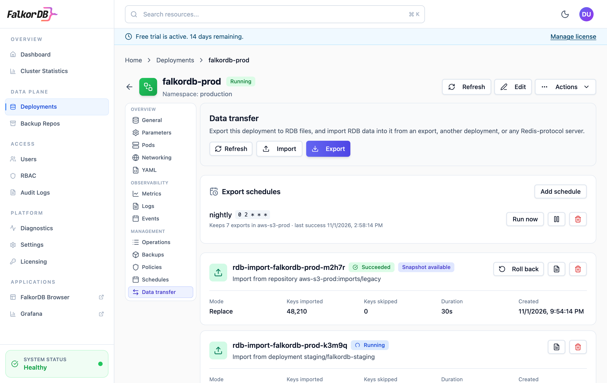
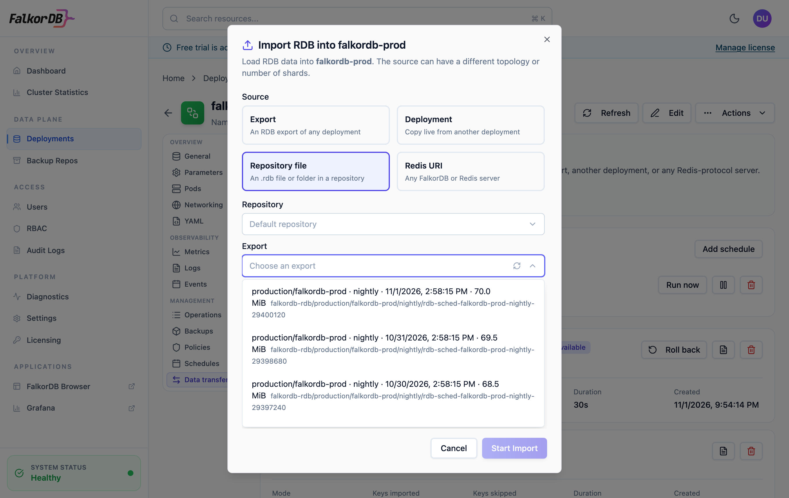
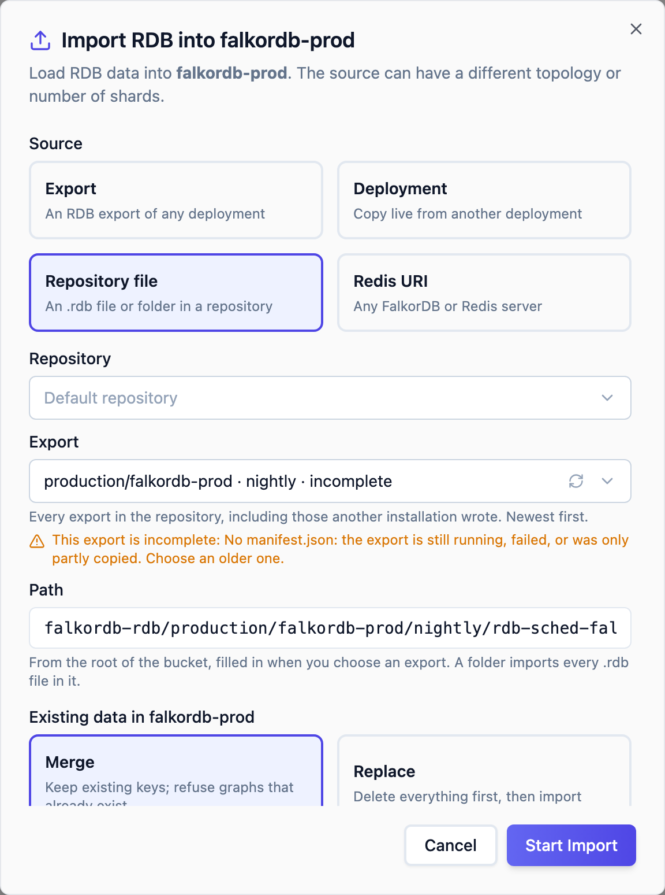
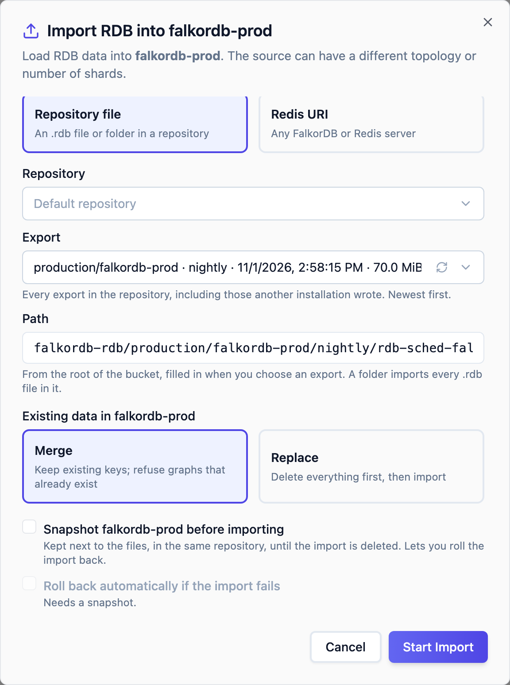

Replicas and Sentinel keep a deployment running when a node or a pod fails. They don't help when you lose the whole Kubernetes cluster or its region. To recover from that, you need a copy of the data outside the region and a second FalkorDB Enterprise installation that can load it.

This page describes a recovery plan built on scheduled [RDB exports](/enterprise/operations/rdb-export-import). The exports go to object storage that survives the outage. If the region is lost, you create the deployments in the recovery region and import the newest export into them.

## How the plan works

| | Primary region | Recovery region |
| --- | --- | --- |
| Kubernetes cluster | Runs your deployments | Runs a standby FalkorDB Enterprise installation, with its own license |
| Object storage | Receives scheduled RDB exports | Holds a copy of the exports: a replicated bucket, or a repository of its own |
| On a regional outage | Lost | You create the deployments and import the newest export |

How much data you can lose (RPO) depends on the age of the newest complete export in the recovery region: how often exports run, how long each takes, any replication delay in the storage, and any run that failed or was skipped. How long recovery takes (RTO) depends on how fast you can create the deployments and import the data. Run a [recovery drill](#test-the-plan) to measure it.

<Warning>
[Backups](/enterprise/operations/backups) (`datafile`, `aof` and `volume-snapshot`) can't be restored in a different Kubernetes cluster through the Admin UI or API. A restore [clones the deployment](/enterprise/operations/restore-new-database) the backup was taken from, and both that deployment and the backup's records live in the lost cluster. Volume snapshots never leave the cluster's storage. Use backups for recovery inside the cluster, and RDB exports for recovery in another region. To restore a lost cluster's backups, contact FalkorDB support.
</Warning>

## Requirements

- A Kubernetes cluster in the recovery region, with FalkorDB Enterprise installed and its own license. A license is bound to one Kubernetes cluster, so register the recovery cluster in the [Enterprise Portal](/enterprise/get-started/enterprise-portal). See [Disaster recovery into a replacement cluster](/enterprise/licensing#disaster-recovery-into-a-replacement-cluster).
- Object storage reachable from both regions.
- In both installations, a [backup repository](/enterprise/operations/backups) on object storage: `s3`, `s3-compatible`, `gcs-s3comp`, `minio`, `azureblob`, `oss`, `obs` or `cos`. Either access method works. RDB exports and imports read and write the bucket directly, so they don't need the `csi-s3` driver.
- A recovery installation running the same FalkorDB version as the primary, or a newer one. An export written by a newer FalkorDB can't be imported into an older one.
- The repository's credentials in a Secret the Admin Server can read. The chart grants it read access to Secrets in `kb-system` and `default`, which covers credentials created by KubeBlocks and by the Admin UI. To keep them elsewhere, add the namespace to `adminServer.rdbTransfer.credentialNamespaces`. Credentials limited to the repository's path prefix are enough; the export list then leaves out exports taken by earlier releases, which are stored outside the prefix. Repositories that rely on cloud IAM roles instead of keys aren't supported for RDB exports.

## Choose where exports are stored

You have two ways to keep exports outside the primary region. You can also use both.

### One bucket replicated by your cloud provider

The primary installation writes exports to one bucket, and the cloud provider copies them to the recovery region.

| Cloud | Storage | Repository in the recovery region |
| --- | --- | --- |
| AWS | S3 bucket with Cross-Region Replication to a bucket in the recovery region | Points at the replica bucket |
| Google Cloud | Dual-region or multi-region Cloud Storage bucket | Points at the same bucket |

For Azure Blob Storage, replicate the container with [object replication](https://learn.microsoft.com/azure/storage/blobs/object-replication-overview) to an account in the recovery region, or use a geo-redundant account and fail it over.

You only manage one export schedule per deployment. Replication is asynchronous, though, so the newest export may not have fully reached the recovery region when the primary region fails. Check what your provider guarantees for replication delay, and add it to your RPO.

S3 replication doesn't copy deletions unless you turn on delete marker replication in the replication rule. Without it, the exports that retention deletes in the primary bucket stay in the replica. Replication needs versioning on both buckets, so a deletion, replicated or made by a lifecycle rule, only hides an object: its earlier version is still stored. To keep the replica's storage from growing:

- Turn on delete marker replication, or add a lifecycle rule that expires current objects older than the exports you keep.
- Add a `NoncurrentVersionExpiration` rule to the replica bucket. Keep noncurrent versions long enough to cover the recovery history you need, so that an export deleted by mistake can still be restored.

In a replica, a `manifest.json` alone doesn't prove that an export is complete: replication can deliver it before the RDB files, and an expiration rule can remove a file the manifest lists. The export list in the recovery installation checks every listed file for you, and marks an export that is missing one as incomplete.

### A repository in each region

The primary installation writes exports to a separate repository in each region, for example `exports-us-east` and `exports-eu-west`. Each repository gets its own export schedule.

This doesn't depend on provider replication, and each repository is written directly. The trade-offs:

- Every export is written twice, which doubles the storage and the traffic between regions.
- Each schedule reads its own snapshot from the deployment. Set the schedules at different times so they don't add load at the same time.

## Set up the primary region

<Steps>
  <Step title="Create the repository">
    In the Admin UI, open **Backup Repositories** and select **New Backup Repository**. Choose the provider, then enter the bucket, region and credentials. To use [a repository in each region](#a-repository-in-each-region), create one repository per region. Note each repository's path prefix, if you set one.
  </Step>
  <Step title="Schedule exports for each deployment">
    In each deployment, open **Data transfer** and click **Add schedule**. Choose the repository, and set how often exports run and how many to keep.

    <Frame caption="A deployment's Data transfer tab, with a nightly export schedule to an S3 repository.">
      
    </Frame>

    How often exports run is only the lower bound of your RPO. Each export also takes time to run and, with a replicated bucket, to reach the recovery region, and a failed or skipped run leaves the previous export as the newest. Pick an interval with room for these, and monitor the age of the newest complete export in the recovery region.

    ```bash
    falkordb-admin rdb schedules create my-graph dr-hourly --namespace prod \
      --schedule "0 * * * *" --retention 24 --repository exports-us-east
    ```

    With a repository in each region, create one schedule per repository, each with its own name.
  </Step>
  <Step title="Keep each deployment's settings outside the region">
    Recovery creates new deployments, so keep a record of each deployment's topology, shard count, CPU, memory, storage and FalkorDB version. One way is to store each deployment's [YAML manifest](/enterprise/databases/yaml) in version control.
  </Step>
</Steps>

Each export is written to its own folder, from the root of the bucket:

```text
<path prefix>/falkordb-rdb/<namespace>/<deployment>/<schedule>/<export name>/
```

The folder holds one `<shard>.rdb` file per shard and a `manifest.json` that lists them. `manifest.json` is written last, and a failed export deletes its folder. Every installation whose repository points at the bucket, or at a replica of it, sees the same folders.

<Note>
Exports taken by earlier releases went through a mounted volume, so they are under that volume's folder in the bucket: `pvc-<id>/<path prefix>/falkordb-rdb/...`. The export list finds them there too, and an import reads them from where they are.
</Note>

## Prepare the recovery region

<Steps>
  <Step title="Install FalkorDB Enterprise">
    Install FalkorDB Enterprise in the recovery cluster with its own license. Keep it on the same release as the primary installation when you upgrade.
  </Step>
  <Step title="Choose a recovery domain">
    If clients connect through [external DNS](/enterprise/deployment/external-dns), give the recovery installation a domain of its own, different from the primary's: for example `dr.db.internal.example.com` next to `db.internal.example.com`. Set it as the installation's default, and point the recovery region's ExternalDNS at that zone:

    ```yaml
    # values.yaml of the recovery installation
    adminServer:
      env:
        clusterExternalDomain: dr.db.internal.example.com
    ```

    Clients have to be reconfigured after a recovery anyway, because a recovered deployment has its own password and certificate, so they change hostnames at the same time. The recovery names are predictable, `<deployment>.dr.db.internal.example.com`, so they can be written into client failover configuration ahead of time.

    With a domain of its own, a recovered deployment publishes its names as soon as it's created, and nothing in the recovery region ever publishes the primary's names. Records left behind in the primary's zone can't send clients to a copy whose data isn't imported yet.
  </Step>
  <Step title="Create the repository">
    Create a backup repository that reads the exports: the replica bucket, the same multi-region bucket, or this region's own repository. Use the same path prefix as the primary installation's repository. The repository can have any name.
  </Step>
  <Step title="Check that the exports are readable">
    Use your cloud provider's tools to list the exports in the bucket, and confirm the newest ones are there:

    ```bash
    aws s3 ls s3://<bucket>/ --recursive | grep 'falkordb-rdb/prod/my-graph/dr-hourly/.*/manifest.json$'
    ```
  </Step>
</Steps>

<Warning>
Don't create export schedules in the recovery installation that write to the same repository under the same namespace, deployment and schedule names as the primary. After each run, a schedule deletes all but its newest folders under `falkordb-rdb/<namespace>/<deployment>/<schedule>/`, and that would include the primary's exports.
</Warning>

## Recover after a regional outage

<Steps>
  <Step title="Confirm the license">
    ```bash
    falkordb-admin license status
    ```

    The license must be `active`. You can't create deployments on an `invalid` license.
  </Step>
  <Step title="Make the storage available">
    With S3 replication, a Google Cloud dual-region or multi-region bucket, or a repository in each region, the exports are already in storage the recovery region can reach. Check that the recovery installation's repository shows `Ready`.
  </Step>
  <Step title="Create the deployments">
    Create each deployment from the settings you recorded, with the same name. It needs at least as much memory as the original, and persistent storage even if the original had none, so that a pod restart doesn't lose the imported data. The topology and shard count can differ, because an import routes each key to the shard that owns it.

    It gets the [recovery domain](#prepare-the-recovery-region) by default. Don't give it the primary's domain: its names would be published before its data is imported.
  </Step>
  <Step title="Import the newest complete export">
    Open the new deployment, select **Data transfer**, and click **Import**. Choose **Repository file**, then the repository. **Export** lists every export in the bucket, newest first, including the ones the primary installation wrote. Choose the newest one of the deployment's schedule.

    <Frame caption="The exports in the repository, read from the bucket: those of the lost installation included.">
      
    </Frame>

    An export marked incomplete is missing a file its manifest lists, for example because replication hadn't finished. Choose an older one.

    <Frame caption="An incomplete export: its manifest hasn't arrived yet.">
      
    </Frame>

    Choosing an export fills in its **Path**. The new deployment is empty, so clear **Snapshot before importing**, then click **Start Import**.

    <Frame caption="Ready to import the newest complete export, without a snapshot of the empty deployment.">
      
    </Frame>

    With the Admin CLI, list the exports and import one by its path:

    ```bash
    falkordb-admin rdb repository-exports my-graph --namespace prod --repository exports-eu-west

    falkordb-admin rdb import my-graph --namespace prod \
      --from-repository exports-eu-west \
      --path <path prefix>/falkordb-rdb/prod/my-graph/dr-hourly/<export name> \
      --rollback none
    ```

    Before writing anything, the import checks every file with the new deployment's own server. It stops if a file is incomplete or was written by a newer FalkorDB.
  </Step>
  <Step title="Check the data">
    When the import succeeds, compare its key count with the `keys` listed in `manifest.json`. Then run a query whose answer you know, for example counting the nodes of a graph.
  </Step>
  <Step title="Move clients to the new deployment">
    The new deployment has its own service names, its own generated password and, with external DNS, names under the recovery domain. Copy them from **Connection Details** on the deployment's **General** tab, and point clients at them.

    With [TLS](/enterprise/databases/tls), the new deployment also has its own certificate, issued for its own names. With the **FalkorDB Enterprise** issuer it gets a new CA too, so clients that trust the original deployment's CA can't connect to it. Give clients the new CA, shown under **Connection Details**. Issuers you control, such as cert-manager or your own certificates, can sign the new deployment with the CA clients already trust. A certificate you provide yourself must cover the recovery names. Before you send production traffic, connect with hostname verification through a recovery name.

    The records the lost region published under the primary's domain stay until ExternalDNS there can clean them up. Remove them by hand if clients that weren't moved should fail fast instead of timing out.
  </Step>
  <Step title="Protect the recovered deployment">
    Set up backups and an export schedule for the recovered deployment. For the export schedule, use a schedule name that is different from the primary's (see the warning in [Prepare the recovery region](#prepare-the-recovery-region)).
  </Step>
</Steps>

## Test the plan

A recovery plan you haven't run is a guess. Run a drill regularly:

1. In the recovery installation, create a deployment in a scratch namespace. Give it a name that no production deployment uses, and keep the recovery domain, or use a domain set aside for drills.

   <Warning>
   [External DNS](/enterprise/deployment/external-dns) names are built from the deployment name and its external domain, not its namespace. Never give a drill deployment the primary's domain: with the same name as a production deployment, it publishes records for production's names, and clients can be sent to the drill copy.
   </Warning>
2. Import the newest export into it, as in [Recover after a regional outage](#recover-after-a-regional-outage).
3. Check the data, and note how long the whole run took. That is the database part of your RTO. Your full RTO also includes deciding to fail over, making the storage available and moving clients over, so add those, or extend the drill until a client request succeeds against the recovered deployment.
4. Delete the scratch deployment.

A drill also shows that the recovery installation's license, repository, credentials and FalkorDB version are still in order.

## Limitations

- Writes made after the newest export that reached the recovery region are lost.
- Exports of a sharded deployment are taken shard by shard. They aren't a consistent copy across shards at one point in time.
- The recovery region has no standby deployments, so recovery takes as long as creating the deployments plus importing the data. There is no automatic failover.
- Backups and point-in-time restore can't be used across Kubernetes clusters. See the warning at the top of this page.
