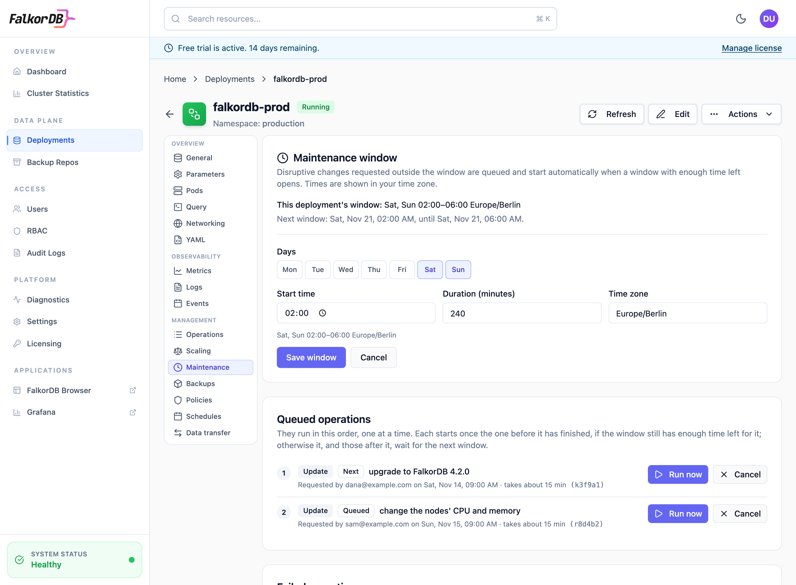
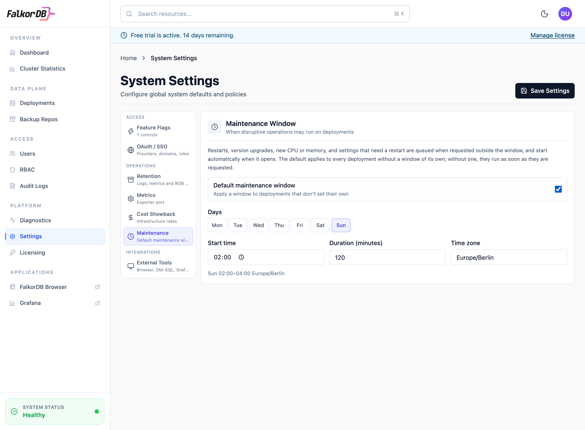
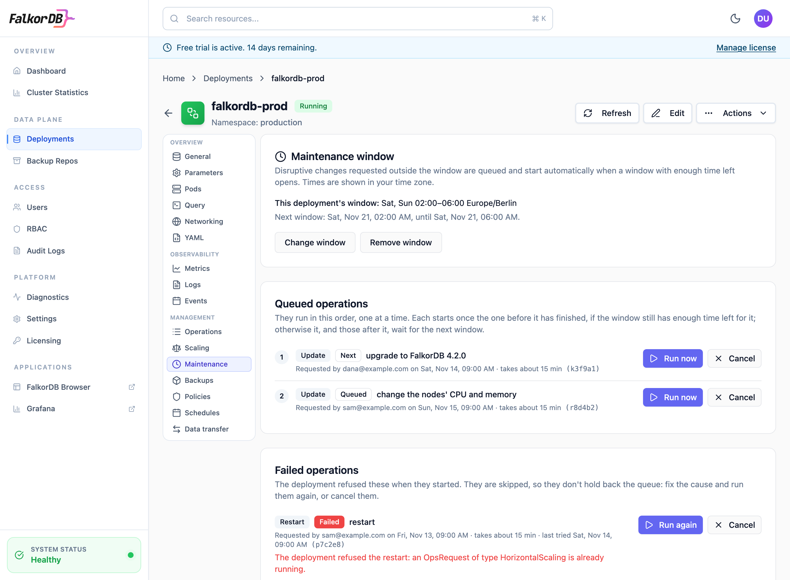
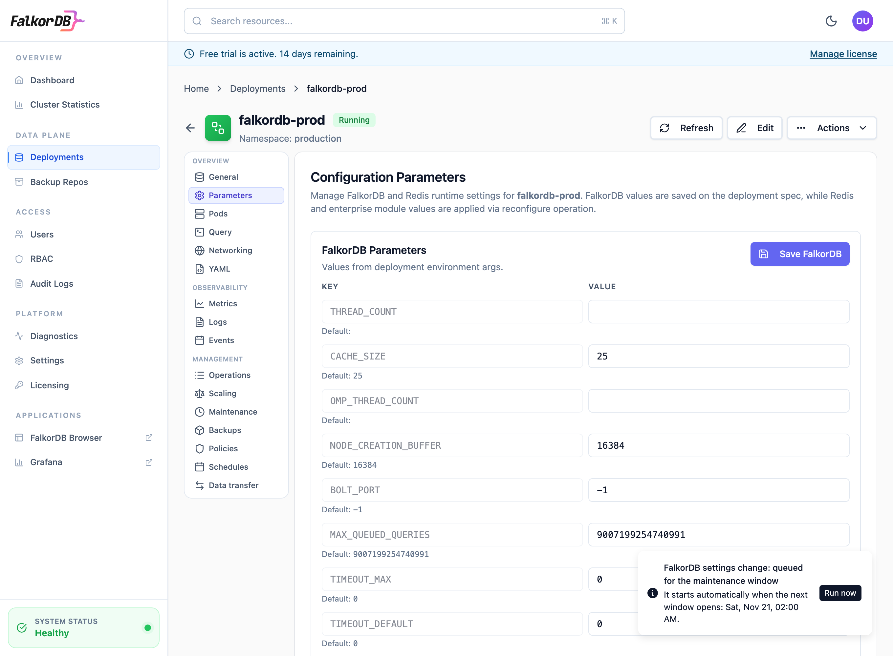
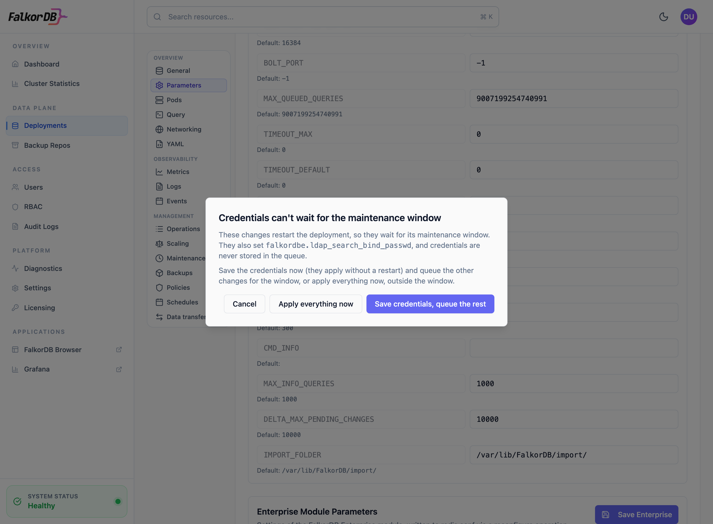
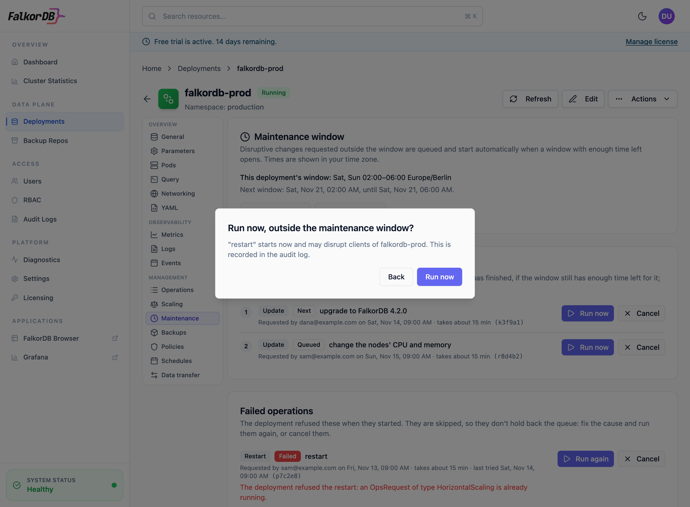

Some changes restart a deployment's nodes. A maintenance window lets you agree when that may happen. A disruptive change requested outside the window is queued, and the Admin Server starts it when the window opens.

## What waits for the window

| Waits for the window | Runs right away |
| --- | --- |
| A restart | Settings that apply without a restart |
| New CPU or memory for the nodes or the sentinels | More storage |
| A FalkorDB version or addon upgrade | More replicas or shards |
| Graph settings, and `redis.conf` or enterprise settings that need a restart | Services, backups, labels |
| Autoscaling that raises memory | Autoscaling that adds shards |
| A new node selector or tolerations for the nodes or the sentinels | Starting, stopping and deleting a deployment |
| Turning the metrics exporter on or off | |
| A new public domain (`externalDomain`), or publishing the pods on their node addresses (`externalAddress`) | |

A deployment without a window, with no installation default either, runs every change right away.

After an upgrade of FalkorDB Enterprise, the Admin Server queues the move of each deployment with a window to a new patch release of its addon (such as `1.7.15` to `1.7.16`), for that window. A move to a new minor or major release is yours to request. It shows in the queue as requested by `system:addon-upgrade`. See [Deployments move to the new addon](/enterprise/upgrades/enterprise#deployments-move-to-the-new-addon).

<Note>
An edit of the deployment's raw YAML (`falkordb-admin deployments update-yaml`, or `POST /api/clusters/{name}/yaml`) is applied as it is, so it isn't queued. Outside the window, an edit that changes the spec is refused with `409`. Make the change through the deployment API instead (`PATCH` or `PUT`), which queues what restarts the pods. You can also apply the YAML in the window, or add `maintenance=override` (`--now` with the Admin CLI).
</Note>

## Set a window

A window has:
- the days it opens
- a local start time
- a duration of 30 minutes to 24 hours
- an IANA time zone, such as `UTC` or `Europe/Berlin`

A window may run past midnight. It is open only while the local clock reads a time inside it. On the night the clocks go forward it may be shorter, and a window that lies wholly in the skipped hour, such as 02:30 for 30 minutes when 02:00 jumps to 03:00, doesn't open that night. On the night they go back, it can open twice: once before the clocks go back, and again when the repeated hour reaches its start.

You can set a window for one deployment when you create it, and change or remove it later.

<CodeGroup>

```json Deployment spec
{
  "spec": {
    "maintenance": {
      "window": {
        "days": ["sat", "sun"],
        "start": "02:00",
        "durationMinutes": 240,
        "timeZone": "Europe/Berlin"
      }
    }
  }
}
```

```bash Remove the window (merge patch)
curl -X PATCH "https://admin.example.com/api/clusters/graph?namespace=team-a" \
  -H "Content-Type: application/merge-patch+json" \
  -d '{"schemaVersion": 1, "spec": {"maintenance": {"window": null}}}'
```

</CodeGroup>

In the Admin UI, open the deployment and select the **Maintenance** tab.

<Frame caption="Changing a deployment's window on the Maintenance tab.">
  
</Frame>

With the Admin CLI:

```bash
falkordb-admin maintenance set graph --namespace team-a --days sat,sun --start 02:00 --duration 4h --timezone Europe/Berlin
```

`--days` also takes ranges and `daily`, `weekdays` or `weekends`. `--duration` takes minutes, or values such as `2h` or `1h30m`. Run `falkordb-admin maintenance clear graph --namespace team-a` to remove the window, and `falkordb-admin maintenance get graph --namespace team-a` to see it with the queue.

### Installation default

An administrator can set a default window under **Settings**, or with `falkordb-admin maintenance default set`. It applies to every deployment that has no window of its own. Through the API, set it with `PATCH /api/settings` using `maintenance.default_window`. Set `default_window` to `null` to clear it.

<Frame caption="The installation default under Settings, Maintenance.">
  
</Frame>

## What happens to a queued change

1. The request is answered with `202 Accepted` and a `queued` entry, not an error. Nothing changes on the deployment yet.
2. The deployment's status lists the change under `pendingChanges` with `via: MaintenanceWindow`. The **Maintenance** tab lists it too, with who requested it and when.
3. Each queued change has an estimated duration of 5 minutes for each pod it restarts, with a minimum of 10 minutes. Only the pods the change restarts count: new CPU for the sentinels counts the sentinels, and an upgrade counts the nodes and the sentinels. The estimate is worked out again just before the change starts, so it follows replicas or shards added in the meantime. A change starts only when a window is open with at least that much time left. A change that started finishes even if it runs past the end of the window.
4. Changes start one at a time, in the order they were requested, and only while the deployment is running with no other operation in progress. Each starts once the one before it has finished, if the window still has enough time left for it. If it doesn't, it waits for the next window, and so do the changes after it, even ones short enough to fit. The **Maintenance** tab numbers the changes in this order.
5. While a change is being submitted it shows as **starting**, and nothing else starts on the deployment. If the Admin Server stops at that moment, the change is submitted again after 10 minutes. A queued restart is never submitted twice.
6. If the deployment refuses a change when it starts, the change stays in the queue marked **failed**, with the reason. It's skipped, so it doesn't hold back later changes, and the **Maintenance** tab lists it apart. Cancel it, or fix the cause and run it again.
7. A queued replacement (`PUT`) only runs on the deployment as it was when it was queued. If its spec, window, labels or annotations have changed since, the replacement is marked failed rather than undo that change: send it again.

The queue is stored on the deployment's KubeBlocks `Cluster`, so it survives Admin Server restarts and is deleted with the deployment. A deployment restored from a backup starts with an empty queue and no window of its own.

<Frame caption="The Maintenance tab: the window, the operations waiting for it in the order they run, and a failed one.">
  
</Frame>

<Frame caption="A settings change made outside the window, queued for it.">
  
</Frame>

<Warning>
The queue is checked once a minute, so a change needs at least a minute less than the whole window. One that needs the whole window or more never starts on its own: it waits until you run it yourself, and the changes queued after it wait behind it. The **Maintenance** tab flags such changes: run it now or cancel it. On the night of a daylight saving change the window can be shorter, or open in two parts, so a change that fits on other nights may wait for the next window.
</Warning>

A change that also sets a credential, such as `falkordbe.ldap_search_bind_passwd` or a Sentinel `requirepass`, can't be queued, because the queue isn't secret. This holds even when the credential already has that value. Resetting a credential to its default is fine. It's refused with `409`, `code: MaintenanceCredentialNotQueueable` and the credentials in `keys`. Credentials apply without a restart, so send them in a request of their own first, then send the rest, which is queued. You can also run the whole change now. The Admin UI offers both choices when this happens.

<Frame caption="A change that also sets a credential: save the credentials now and queue the rest, or apply everything now.">
  
</Frame>

## Cancel or run a change now

- **Cancel**: `DELETE /api/clusters/{name}/maintenance/queue/{id}?namespace={namespace}`. You need permission to update the deployment.
- **Run now**: `POST /api/clusters/{name}/maintenance/queue/{id}/run?namespace={namespace}`. This starts the change outside the window.

- **Skip the window when you make the change**: add `maintenance=override` to the request. For example, `PATCH /api/clusters/graph?namespace=team-a&maintenance=override`. This works on deployment `PUT` and `PATCH`, and on `POST .../ops/restart`, `.../ops/configure`, `.../ops/vertical-scale` and `.../upgrade`.

With the Admin CLI, use `falkordb-admin maintenance cancel <deployment> <id>` and `falkordb-admin maintenance run <deployment> <id>`. Add `--now` to a command that makes a disruptive change, such as `deployments upgrade` or `operations restart`, to skip the window.

<Frame caption="Running a queued change now asks for confirmation, and is recorded in the audit log.">
  
</Frame>

Running now and overriding need the `override` action on the `clusters.maintenance` resource. The predefined `admin` role has it. To give it to other people, add a rule to their role:

```json
{ "resource": "clusters.maintenance", "actions": ["override"], "namespace": "all" }
```

## Audit log

These events are written to the audit log:

| Event | Action |
| --- | --- |
| A change was queued | `cluster.maintenance.queue` |
| A queued change started in a window | `cluster.maintenance.run` |
| A change ran outside the window | `cluster.maintenance.override` |
| A queued change was cancelled | `cluster.maintenance.cancel` |
| A queued change was refused | `cluster.maintenance.fail` |

The change itself is also audited under its usual action, such as `cluster.update` or `cluster.ops.restart`, with the person who requested it as the user.

## Check the window

`GET /api/clusters/{name}/maintenance?namespace={namespace}` returns:
- the window that applies, and whether it's the deployment's own or the installation default
- the window open now, if any, and when the next one opens
- the queue
