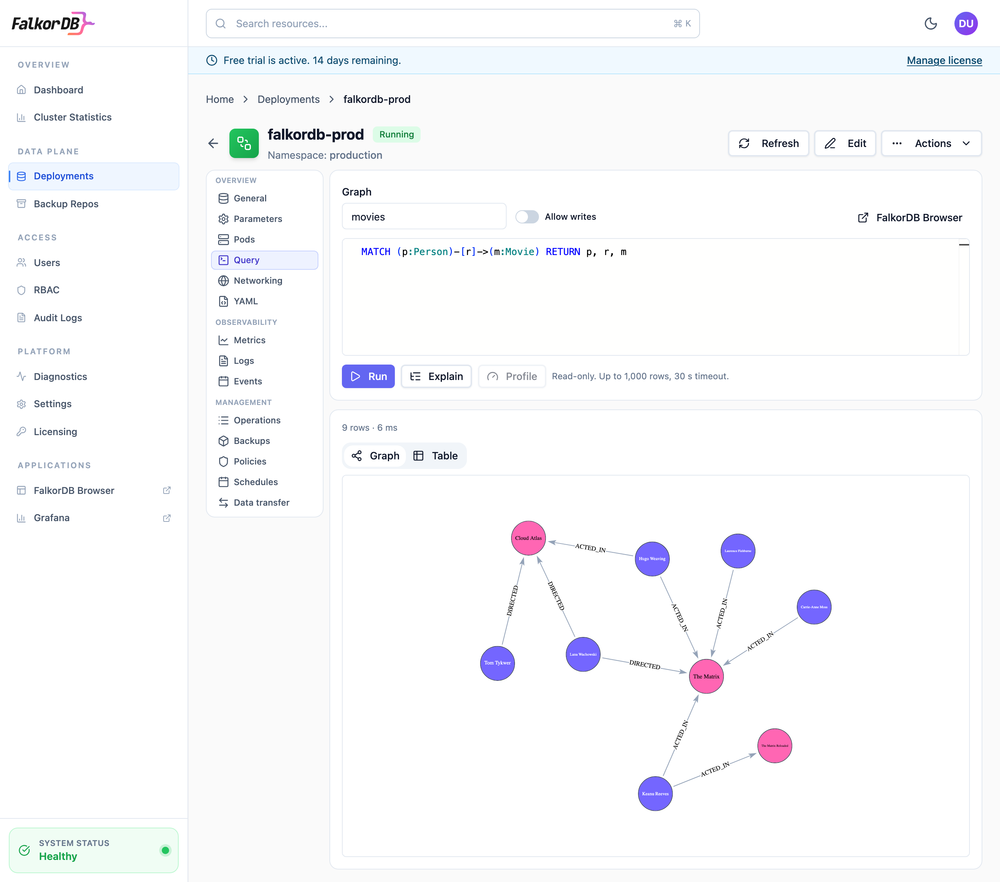
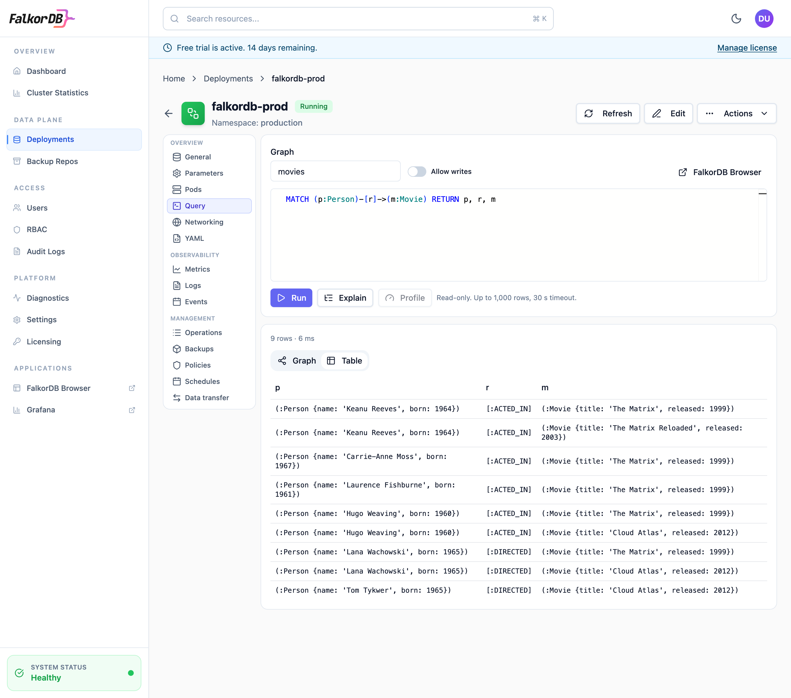
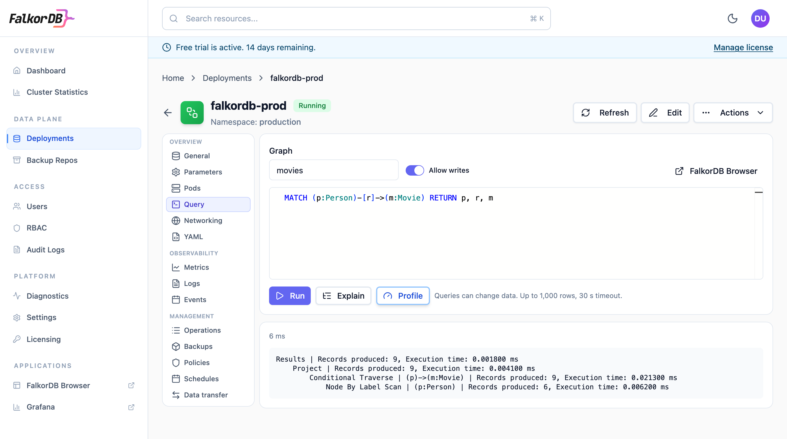
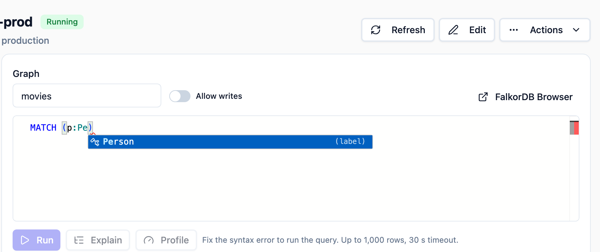
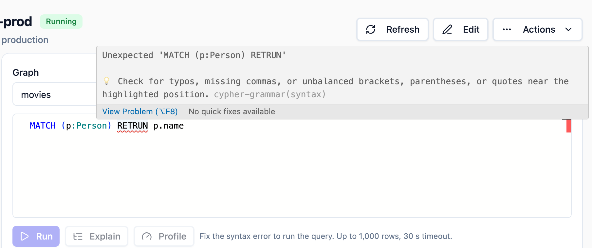

The query console runs Cypher against a deployment from its page in the Admin UI. Use it for quick checks: whether the data is there, what a query returns, or why it is slow. For saved queries, schema work, and anything longer, use FalkorDB Browser; the console links to it when a Browser URL is configured.

## How it works

The Admin UI sends each query to the Admin Server, which runs it with the deployment's default account and returns the result. You never handle the deployment's password, and the Admin UI's roles decide who may query what.

- **Routing.** The Admin Server connects to the deployment from inside the Kubernetes cluster. On a sharded deployment, each query goes to the shard that owns the graph. With Sentinel, the Admin Server looks up the current primary for each request and connects to it directly. A request made during a failover can fail; run it again once the new primary is up.
- **Connections.** Each request opens its own connection and closes it when the reply arrives.
- **TLS.** When the deployment uses TLS, the connection does too. The server certificate is always checked: against the deployment's CA when it has one, otherwise against the Admin Server's system trust store, so a connection to a certificate neither trusts fails rather than sending the password. Its host name is not checked, because shards are reached at the addresses they announce, which the certificate doesn't list.

## Run a query

<Steps>
  <Step title="Open the console">
    Open the deployment in the Admin UI and click **Query**. The tab only appears for roles with the `read` action on `clusters.query`.
  </Step>
  <Step title="Pick a graph">
    The **Graph** field suggests the graphs in the deployment. You can also type the name of one that doesn't exist yet, to create it with a write query.
  </Step>
  <Step title="Run the query">
    Enter the Cypher and click **Run**, or press <kbd>Ctrl</kbd>+<kbd>Enter</kbd> (<kbd>⌘</kbd>+<kbd>Enter</kbd> on macOS). Queries run read-only unless you turn on **Allow writes**.
  </Step>
</Steps>

When a result contains nodes or relationships, the console shows them as a graph first; switch to **Table** to see every column. Scalar results show as a table.

<Frame caption="A query that returns people and the movies they acted in or directed, shown as a graph.">
  
</Frame>

<Frame caption="The same result as a table, with nodes and relationships written as Cypher patterns.">
  
</Frame>

**Explain** returns the query's execution plan without running it. **Profile** runs the query and returns the plan with the records each operation produced and the time it took.

<Warning>
**Profile** executes the query. A profiled `CREATE`, `SET`, or `DELETE` changes data, so Profile needs the `write` action, and the console enables it only while **Allow writes** is on.
</Warning>

Profile runs with the same timeout as a query, and FalkorDB stops it there. On a sharded deployment the console can't send that timeout to the shard that holds the graph, so Profile isn't available there; use Explain, or FalkorDB Browser.

<Frame caption="Profile shows each operation of the plan with the records it produced and the time it took.">
  
</Frame>

## Autocomplete and syntax checking

The editor uses the same Cypher engine as FalkorDB Browser. As you type, it suggests the keywords, functions, and procedures that fit where the cursor is, and the selected graph's labels, relationship types, and property keys. Press <kbd>Ctrl</kbd>+<kbd>Space</kbd> to open the suggestions yourself.

<Frame caption="Suggestions come from the selected graph: here, its Person label.">
  
</Frame>

The query is checked as you type. A syntax error is underlined, and hovering it shows what is wrong and how to fix it. **Run**, **Explain**, and **Profile** stay disabled until the query parses. The check covers syntax only; errors such as an unknown function or a missing graph are still reported when the query runs.

<Frame caption="A misspelled RETURN is underlined, and the console won't run the query until it is fixed.">
  
</Frame>

## Limits

Each query, Profile included, runs with a timeout, passed to FalkorDB as `TIMEOUT`, and returns at most a fixed number of rows to the browser. When a result has more rows, the console says so; add a `LIMIT` or use FalkorDB Browser. The Admin Server still receives the full result before it drops the extra rows, so the timeout is what protects the database.

| Value | Default | Purpose |
| --- | --- | --- |
| `adminServer.queryConsole.enabled` | `true` | Turns the console on or off. When off, the **Query** tab says the console is disabled and the Admin Server never connects to database pods. |
| `adminServer.queryConsole.maxRows` | `1000` | Rows returned to the browser per query. |
| `adminServer.queryConsole.timeoutMs` | `30000` | Query timeout, in milliseconds. |

When the license has expired or is invalid, the console can still run read-only queries and Explain. Write queries and Profile are refused, like other changes.

## Permissions

The console uses the `clusters.query` resource:

| Action | Allows |
| --- | --- |
| `read` | Listing graphs, running read-only queries (`GRAPH.RO_QUERY`), and Explain |
| `write` | Running queries that change data (`GRAPH.QUERY`), and Profile |

Rules can be scoped to a namespace like any other rule. The predefined **admin** and **operator** roles have both actions. The **viewer** role has neither, because query results show the data itself.

## Audit log

Every query, Explain, and Profile is recorded in the audit log as `cluster.query.execute`, `cluster.query.explain`, or `cluster.query.profile`. The entry names the user, the deployment, and the graph, whether the query ran read-only, how many rows it returned, and how long it took. A failed query records only the kind of failure (`rejected`, `not_found`, `unavailable`, `timeout`, or `internal`), because database errors can quote the query; the full error is shown only to the user who ran it.

The entry holds a SHA-256 hash of the query and its length, not its text, and never the results. Literals in a query can carry the same data as its results; the hash still lets you match an entry to a query you have.

## Network policy

With `networkPolicy.enabled`, the chart lets the Admin Server reach database pods on 6379 and 26379 in every namespace while the console is enabled. Set `adminServer.queryConsole.enabled=false` to drop that rule. See [Network policies](/enterprise/reference/network-policy).
