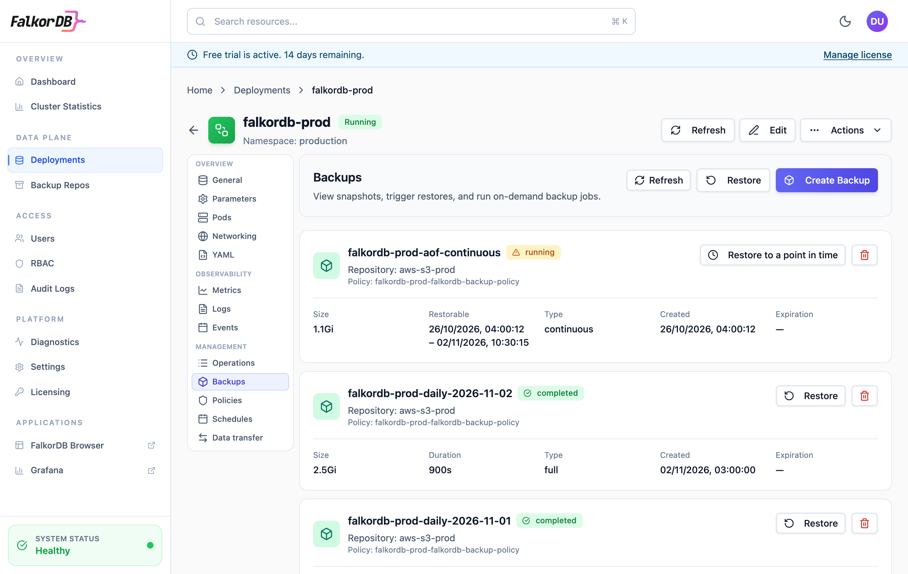
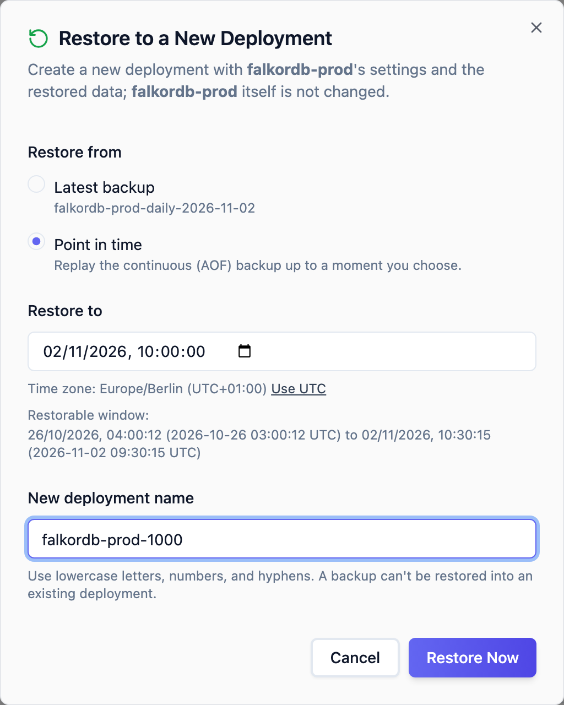
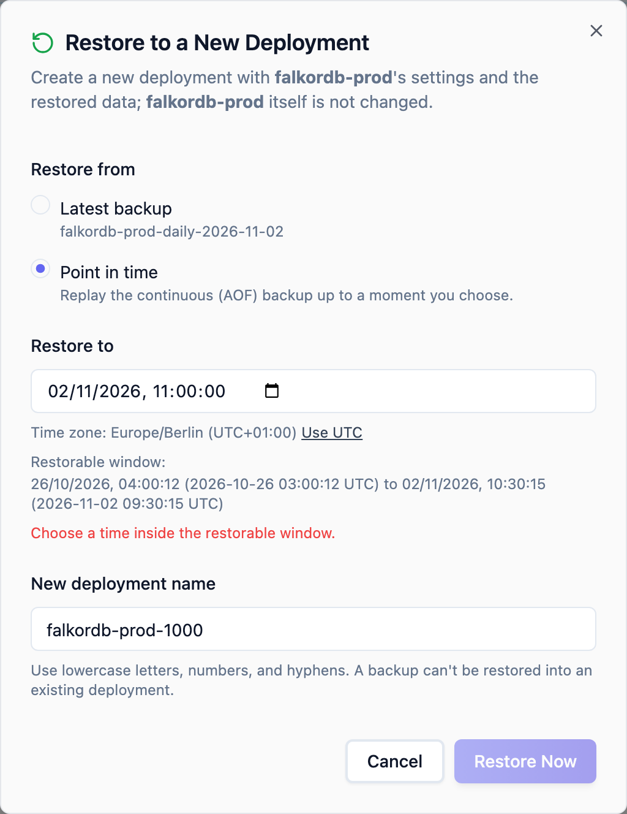

A point-in-time restore creates a new deployment with the data a deployment held at a moment you choose, to the second. It replays a continuous backup, which archives the FalkorDB append-only file (AOF) as it is written, so it can return to any moment the archive covers rather than only to the moment a full backup was taken.

Like every restore, it creates a new deployment and leaves the source unchanged. See [Restore to a new deployment](/enterprise/operations/restore-new-database) for what the new deployment copies from the source.

It works for standalone, replication and sharded deployments. A sharded deployment is restored to the same second on every shard, with the caveats in [Sharded deployments](#sharded-deployments).

## Turn on continuous backups

Continuous backups come from a backup schedule that uses the `aof` method.

<Steps>
  <Step title="Create an aof schedule">
    Open the deployment, go to **Schedules**, and select **New Schedule**. Choose the `aof` backup method and set **Retention** to how far back you want to be able to restore, for example `7d`.

    With the API:

    ```text
    POST /api/clusters/<deployment>/backups/schedules?namespace=<namespace>
    ```

    ```json
    {
      "scheduleName": "<deployment>-pitr",
      "backupMethod": "aof",
      "frequency": "0 3 * * *",
      "retentionPeriod": "7d"
    }
    ```

    The cron frequency doesn't time anything for `aof`: the continuous backup starts as soon as the schedule is enabled and runs until it is disabled.

    On a sharded deployment created before this release, the schedule can be refused with `Backup method 'aof' is not supported by backup policy`. KubeBlocks adds the new method to a deployment's backup policy the next time it reconciles the deployment. Change any annotation on the deployment to make it reconcile now, then create the schedule again:

    ```bash
    kubectl annotate clusters.apps.kubeblocks.io <deployment> -n <namespace> \
      falkordb.cloud/backup-policy-sync="$(date +%s)" --overwrite
    ```
  </Step>
  <Step title="Check that it is archiving">
    Go to **Backups**. A backup of type `continuous` appears with the status `running`. It stays `running` for as long as the schedule is enabled. Its **Restorable** field shows the range it covers once it has archived something.

    <Frame caption="A continuous backup next to the daily full backups. Restorable is the range it can restore to.">
      
    </Frame>

    ```bash
    kubectl get backups.dataprotection.kubeblocks.io -n <namespace> \
      -l dataprotection.kubeblocks.io/backup-type=Continuous \
      -o custom-columns=NAME:.metadata.name,STATUS:.status.phase,START:.status.timeRange.start,END:.status.timeRange.end
    ```
  </Step>
  <Step title="Keep full backups too">
    Keep a `datafile` or `volume-snapshot` schedule next to the `aof` one (sharded deployments offer `datafile` only). A continuous backup doesn't carry [offloaded graphs](#limitations), and a full backup is what you restore when a point in time isn't needed.
  </Step>
</Steps>

The continuous backup needs FalkorDB to stamp a time into the AOF. The addon's FalkorDB configuration turns `aof-timestamp-enabled` on for every deployment, and the continuous backup turns on `aof-disable-auto-gc` itself while it runs, so FalkorDB keeps its AOF files until they are archived. Leave `aof-timestamp-enabled` set to `yes`: if it is off, the continuous backup stops with an error and archives nothing. To check it:

```bash
kubectl exec -n <namespace> <deployment>-falkordb-0 -c falkordb -- \
  sh -c 'redis-cli --no-auth-warning -a "$REDIS_DEFAULT_PASSWORD" CONFIG GET aof-timestamp-enabled'
```

## What decides the restorable window

The window runs from the oldest archived data to the newest:

| Edge | What sets it |
| --- | --- |
| Earliest | The schedule's retention. Archived AOF older than the retention is deleted, so the earliest restorable time stays roughly one retention period behind the present. It moves in steps, each time FalkorDB rewrites its AOF and an older part of the archive expires. |
| Latest | How far the archive has caught up. The archive is shipped every few seconds, and the latest time keeps moving forward even while nothing is written. It trails the present by several seconds, since the addon only claims a second once its writes are certain to be in the uploaded archive. Writes made after it aren't in a restore, so stop writes and wait for the latest time to pass them when you need everything. |

The archive starts from the snapshot FalkorDB took at its last AOF rewrite before the schedule was enabled, so the window can begin somewhat before you enabled the schedule. Go by the window the Admin Server reports, not by when you enabled it. Disabling the schedule stops the archive, and the window then ends at that point. If enabling it again starts a new continuous backup, that backup has a window of its own, so a deployment can have several windows with a gap between them. A continuous backup that fails keeps the window it archived before failing.

The window doesn't depend on full backups. The continuous backup archives its own copies of the data the AOF builds on, so it restores without a separate full backup.

To see the window:

<CodeGroup>
```text API
GET /api/clusters/<deployment>/restores/window?namespace=<namespace>
```

```bash CLI
falkordb-admin backups restore-window <deployment> --namespace <namespace>
```
</CodeGroup>

```json
{
  "timeZone": "UTC",
  "ranges": [
    {
      "backupName": "<continuous-backup>",
      "backupNamespace": "<namespace>",
      "earliest": "2026-10-26T03:00:12Z",
      "latest": "2026-11-02T09:30:15Z"
    }
  ]
}
```

`ranges` lists each window, latest first. Times are UTC. When `ranges` is empty, `reason` says why: there is no continuous backup yet, or, on a sharded deployment, the shards don't share a time yet or the shard count has changed since the backup started (see [Sharded deployments](#sharded-deployments)).

## Restore

The restore time must be inside a window. A restore aimed outside the window is rejected with the window in the error message.

### Admin UI

1. Open the deployment, then go to **Backups**.
2. Select **Restore** at the top of the page, or **Restore to a point in time** on the continuous backup.
3. Under **Restore from**, choose **Point in time**.
4. Choose a date and time. The picker starts at the latest restorable time, in your browser's time zone, which is shown under it. Select **Use UTC** to choose the time in UTC instead. The restorable window is listed in both your time zone and UTC.
5. Enter a name for the new deployment.
6. Select **Restore Now**.

<Frame caption="Restoring falkordb-prod as it was at 10:00 Berlin time, 09:00 UTC.">
  
</Frame>

A time outside the window keeps **Restore Now** disabled:

<Frame caption="11:00 Berlin time is after the latest restorable time.">
  
</Frame>

<Note>
On the day the clocks go back, an hour of local times happens twice, and the picker refuses a time in that hour: switch it to UTC to say which one you mean. A local time skipped when the clocks go forward is refused too. When the latest restorable time falls in a repeated hour, the picker starts in UTC.
</Note>

### API

```text
POST /api/clusters/<deployment>/restores/clone?namespace=<namespace>
```

```json
{
  "newClusterName": "<new-deployment>",
  "restoreTime": "2026-11-02T08:00:00Z"
}
```

`restoreTime` is UTC, to the second. `backupName` can be left out: the Admin Server uses the continuous backup whose window holds the time. If you give `backupName`, it must name that continuous backup.

A point-in-time restore uses only the deployment's own continuous backups, in its own namespace. Leave out `backupNamespace`, or set it to the deployment's namespace.

The request is rejected with `400` when the time is outside every window, when `backupNamespace` names another namespace, when `backupName` names a backup that isn't a continuous one, or when the backup is a sharded deployment's and its shard count has changed since the backup started.

### CLI

```bash
falkordb-admin backups clone <deployment> --namespace <namespace> \
  --newClusterName <new-deployment> --restore-time 2026-11-02T10:00:00+02:00
```

`--restore-time` takes any ISO 8601 time with a zone, and the CLI sends it to the API in UTC. A time without a zone is refused, so that a restore never lands at the wrong hour.

## Check the restored data

```bash
kubectl get clusters.apps.kubeblocks.io -n <namespace> <new-deployment>
kubectl get restores.dataprotection.kubeblocks.io -n <namespace> \
  -o custom-columns=NAME:.metadata.name,PHASE:.status.phase | grep '^<new-deployment>-'
```

`Running` alone doesn't mean the data is in. A sharded deployment reports `Running` once its shards form, and only then imports each shard's data, which can take a while longer. Wait until every restore whose name starts with the new deployment's name shows `Completed`. A sharded deployment has two per shard, one that prepares the shard's data and one that imports it. If one shows `Failed`, the new deployment is incomplete: delete it and restore again.

The new deployment's `kubeblocks.io/restore-from-backup` annotation names the continuous backup and the `restoreTime`. Check the data itself before you move applications to it: look for a write you know happened just before the restore time, and confirm that one made just after it is missing.

## Sharded deployments

Each shard archives its own AOF, from one of its replicas, or from its primary when it has none. The window the Admin Server reports for a sharded deployment is the time every shard covers: from the latest of the shards' earliest times to the earliest of their latest times. While any shard has archived nothing yet, or has stopped archiving, there is no window.

A restore replays every shard's archive up to the same restore time and writes the result into the new deployment, so each key lands on the shard that owns its slot there. The new deployment has as many shards as the source, but its own slot layout.

- **Writes across shards.** The shards agree on the restore time to the second, and to how closely the clocks of their nodes agree. A write that touched several shards, such as a client writing keys of different slots one after another, can come back on one shard and not another when it spans the restore time.
- **After a change in shard count.** KubeBlocks fixes a continuous backup's shards when it starts, so after a scale-out the new shard is never archived, and a restore to a time before a scale-in would need the old shard count, which nothing records. Once a sharded deployment has a different number of shards than its continuous backup archives, the Admin Server leaves that backup out of the window, refuses to restore from it, and replaces it, whether the deployment was scaled in the Admin UI or not. Within a minute of the scale, it:

  1. disables the `aof` schedule. A scale-in waits for this: the continuous backup reads a removed shard's volume, which KubeBlocks can't delete while it's in use;
  2. waits for the old continuous backup to stop running, and for any new deployment still being restored from it, then deletes it. A restore from it that failed holds this step until you delete the deployment it was creating;
  3. once the deployment is `Running` with its new shards, enables the schedule again, and KubeBlocks starts a new continuous backup.

  The new window begins when the new backup has archived every shard, a few minutes after the scale. Times before that can only be restored from a full backup, and a full backup taken before the scale restores to as many shards as it holds. Each step appears in the audit log, as `system:continuous-backups`.

  The Admin Server checks the shard count every minute. If a deployment is scaled and scaled back to its old shard count within that time, the continuous backup isn't replaced, and a shard that existed only in between was never archived: a restore to a time while it held slots can miss the writes to them. Scale one step at a time, or check the restored data for that period.

  The Admin Server does this for an `aof` schedule created on the **Schedules** tab or with the API. For an `aof` entry enabled in a schedule KubeBlocks generated, take the same steps by hand: a running backup can't be deleted, and enabling the schedule again without deleting the backup resumes the old one.

## Limitations

- **Replication lag.** A continuous backup archives a replica when the deployment has one. A replica stamps a write with the time it applies it, not the time the primary committed it, so a write committed within the replication lag before the restore time (usually milliseconds) can be left out.
- **Offloaded graphs.** A continuous backup doesn't package the dump files of [offloaded graphs](/enterprise/operations/graph-offloading), so it can't be relied on to bring them back. Restore a `datafile` or `volume-snapshot` backup, which the restore flow treats as full backups, when you need offloaded graphs.
- **Restore in place.** Like every restore, a point-in-time restore creates a new deployment. See [Restore in place](/enterprise/operations/restore-same-database) for how to replace a deployment's data.
- **One-second precision.** The restore keeps every write stamped at or before the chosen second and drops the rest.
